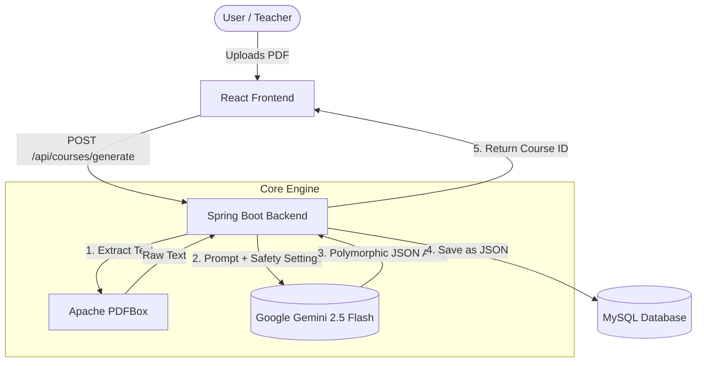

# 🚀 AI Interactive Course Engine

Turn any static textbook (PDF) into a highly engaging, gamified, and interactive split-screen course in seconds using the power of Google Gemini.

## 🌟 The Vision & Innovation
Traditional e-learning is boring. Reading static PDFs leads to high drop-off rates. 
**AI Interactive Course Engine** disrupts this by using AI not just as a chatbot, but as an **Engine** that dynamically generates structured, polymorphic UI components (Theory, Fill-in-the-blanks, Scenarios) directly from raw text.

### Key Features:
- **Polymorphic UI Generation**: Gemini 2.5 Flash outputs a strict JSON array of different block types.
- **Split-Screen UX**: Theory stays on the left for reference, while interactive challenges appear on the right.
- **Gamification**: Built-in Framer Motion animations and Canvas Confetti to reward correct answers.
- **Responsible AI**: Fully integrated with Gemini Safety Settings to ensure educational content is safe and appropriate.

---

## 🏗️ Architecture



---

## 🛡️ Responsible AI & Safety
We strictly adhere to Google's Safety Guidelines. Our integration with the Gemini API explicitly configures `SafetySettings` to block dangerous content, hate speech, harassment, and sexually explicit material at the `BLOCK_LOW_AND_ABOVE` threshold. This ensures the platform is 100% safe for students of all ages.

---

## ⚡ 1-Click Installation (For Judges)

We have fully Dockerized the entire stack (Database, Backend API, and Frontend UI) for your convenience.

### Prerequisites:
- Docker and Docker Compose installed.
- A Google Gemini API Key.

### Step 1: Export your API Key
Open your terminal in the root directory of this repository and export your Gemini API key:
```bash
export GEMINI_API_KEY="your_api_key_here"
```

### Step 2: Spin up the entire stack
Run the following command:
```bash
docker compose up -d --build
```

### Step 3: Experience the Magic!
- **Frontend UI**: Open your browser and navigate to `http://localhost:5173`
- **Upload a PDF** (e.g., a chapter on history or programming) and wait a few seconds.
- Enjoy the generated interactive course!

*(Note: The MySQL Database runs on port 3306, the Spring Boot Backend runs on port 8080, and phpMyAdmin is available on port 8081 for debugging).*
