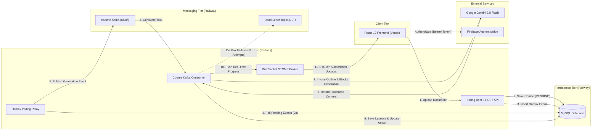

# AI Interactive Course Engine

Event-driven, asynchronous learning platform that transforms static documents into interactive courses using Google Gemini, Apache Kafka, and Spring Boot.

---

## Architecture Overview

The system utilizes an asynchronous Event-Driven Architecture combined with the Transactional Outbox Pattern to decouple file ingestion from computationally intensive LLM operations.



---

## Architectural Highlights

### 1. Transactional Outbox Pattern
Avoids distributed transaction failure (Dual-Write Problem) between MySQL and Apache Kafka. When a user requests course generation:
- The `courses` entity is created with status `PENDING`.
- An `outbox_events` record containing the serialized payload is committed within the same database transaction.
- A scheduled relay (`OutboxPublisherService`) polls pending records every 2 seconds and publishes them to Kafka with `PROCESSED` state tracking.

### 2. Kafka Message Processing and Fault Tolerance
- **Broker Mode:** Apache Kafka running KRaft mode (Kafka Raft Metadata mode without ZooKeeper dependency).
- **Authentication:** Configured with `SASL_PLAINTEXT` and `PLAIN` JAAS credentials over private cloud networking.
- **Retry Mechanism:** Configured via `@RetryableTopic` with 3 attempts and exponential backoff (2000ms delay, multiplier 2.0).
- **Dead Letter Topic (DLT):** Unrecoverable failures are routed to `course-engine-topic-dlt` with non-blocking error handling to ensure offsets are committed and poison pill records do not stall the consumer group.
- **Idempotent Consumption:** Evaluates existing course states before invoking AI generation to prevent redundant LLM invocations upon network replays.

### 3. Real-Time Status Streaming
A Spring WebSocket STOMP broker publishes granular progress updates (`/topic/course/{courseId}`) to the client:
- Stage 1: Document text extraction.
- Stage 2: Curriculum outline generation.
- Stage 3: Interactive exercise synthesis per chapter.
- Stage 4: Course readiness notification.

### 4. API Security and Rate Limiting
- **Authentication:** Stateless verification of Firebase JWT Bearer tokens against Google's JWKS endpoint using Spring Security OAuth2 Resource Server.
- **Rate Limiting:** Token-bucket algorithm (Bucket4j) per user/IP address on expensive generative endpoints.
- **Circuit Breaker:** Resilience4j Circuit Breaker guarding external LLM requests against upstream latency or quota degradation.

---

## Interactive Learning Features

- **Document Parser:** Extracts and normalizes textual content from uploaded PDF documents.
- **Adaptive Curriculum Synthesis:** Automatically partitions documents into ordered chapters and summaries.
- **Interactive Block Generation:**
  - **Theory Blocks:** Markdown-formatted conceptual explanations.
  - **Fill in the Blanks:** Fuzzy-matching text inputs testing recall.
  - **Scenarios:** Contextual multiple-choice questions with feedback explanations.
  - **Code Editor:** In-browser coding challenges with syntax verification for technical documents.
  - **Drag and Drop:** Terminology and concept categorization exercises.
- **Contextual AI Tutor:** Learners can highlight any paragraph in a lesson to invoke contextual AI explanations.
- **Smart Notebook:** Highlighting and notes persist to MySQL per user account.
- **Integrated Pomodoro Timer:** Floating study timer with customizable intervals.

---

## Technology Stack

### Backend
- Language: Java 21 (OpenJDK)
- Framework: Spring Boot 3.2.5
- Persistence: Spring Data JPA, Hibernate
- Messaging: Spring Kafka (Apache Kafka KRaft client)
- Realtime: Spring WebSocket (STOMP protocol)
- Security: Spring Security 6, OAuth2 Resource Server (Firebase JWT)
- Resilience: Resilience4j, Bucket4j

### Messaging & Storage
- Message Broker: Apache Kafka (KRaft mode, SASL_PLAINTEXT authentication)
- Database: MySQL 8.0

### Frontend
- Framework: React 19, TypeScript
- Build Tool: Vite
- Styling: TailwindCSS
- Realtime Client: StompJS, SockJS
- Authentication: Firebase Client SDK
- Icons: Lucide React

### Infrastructure & Deployment
- Backend & Database: Railway Cloud (Private Networking between Spring Boot, MySQL, and Kafka)
- Frontend: Vercel (Edge network deployment with SPA rewrites)

---

## Configuration Reference

Key environment variables across services:

| Variable | Description | Example |
| :--- | :--- | :--- |
| `SPRING_DATASOURCE_URL` | JDBC MySQL connection URL | `jdbc:mysql://localhost:3306/course_engine` |
| `SPRING_DATASOURCE_USERNAME` | MySQL database user | `root` |
| `SPRING_DATASOURCE_PASSWORD` | MySQL database password | `secret` |
| `SPRING_KAFKA_BOOTSTRAP_SERVERS` | Kafka broker address | `localhost:9092` |
| `SPRING_KAFKA_SECURITY_PROTOCOL` | Kafka security protocol | `SASL_PLAINTEXT` (or `PLAINTEXT`) |
| `SPRING_KAFKA_SASL_MECHANISM` | SASL authentication mechanism | `PLAIN` |
| `SPRING_KAFKA_SASL_JAAS_CONFIG` | JAAS login module configuration | `org.apache.kafka.common.security.plain.PlainLoginModule required ...;` |
| `GEMINI_API_KEY` | Google Gemini API Key | `AIzaSy...` |
| `FIREBASE_ISSUER_URI` | Firebase JWT issuer URL | `https://securetoken.google.com/<project-id>` |
| `FIREBASE_JWK_SET_URI` | Firebase JWKS certificate URI | `https://www.googleapis.com/service_accounts/v1/jwk/securetoken@system.gserviceaccount.com` |
| `VITE_API_BASE_URL` | Frontend REST API endpoint | `https://api.yourdomain.com/api` |

---

## Local Development Setup

### Prerequisites
- Node.js 18+
- Java 21 JDK
- Maven 3.9+
- Docker & Docker Compose (for local MySQL and Kafka)

### 1. Start Infrastructure Dependencies
A `docker-compose.yml` file is provided in the root directory:
```bash
docker compose up -d
```

### 2. Configure and Run Backend
Navigate to the backend directory:
```bash
cd backend
```

Ensure environment variables are populated, then build and run:
```bash
./mvnw spring-boot:run
```
The server will initialize on port `8080`.

### 3. Configure and Run Frontend
Navigate to the frontend directory:
```bash
cd frontend
npm install
npm run dev
```
The client will be available at `http://localhost:5173`.

---

## Performance and Chaos Testing

The repository includes standalone load testing suites (`load_test.py` and `advanced_load_test.py`):
- **Concurrency Verification:** Simulates concurrent course generation requests against the Outbox pipeline.
- **Transaction Isolation:** Validates course cloning under concurrent read/write locks to prevent MySQL deadlocks.
- **Failover Handling:** Tests Kafka consumer recovery upon transient broker disconnection.
